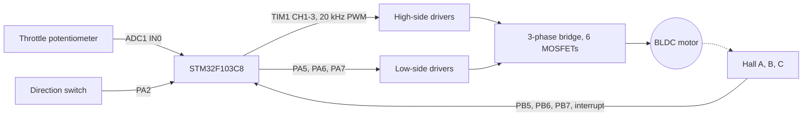

# Hall-sensored BLDC motor driver with six-step commutation

STM32F103 · TIM1 PWM · hall interrupts · throttle and direction inputs

   

**English** | [Türkçe](README.tr.md) · An open-source project by [TECH-OHM](https://tech-ohm.com)

Firmware for a Blue Pill (STM32F103C8) that drives a hall-sensored brushless DC motor with six-step commutation. Speed comes from a throttle potentiometer and direction from a switch. Think of it as the simplest form of an e-bike or light EV controller: there is no current loop, only voltage (duty) control.

## Block diagram

## Pins

| Pin | Function | Notes |
|---|---|---|
| PA0 | Throttle | ADC1 channel 0, 0 to 3.3 V |
| PA2 | Direction | 0 forward, 1 reverse. Read only while the motor is stopped |
| PA8 | Phase A high side | TIM1 CH1, PWM |
| PA9 | Phase B high side | TIM1 CH2, PWM |
| PA10 | Phase C high side | TIM1 CH3, PWM |
| PA5 | Phase A low side | GPIO, on for the whole step |
| PA6 | Phase B low side | GPIO |
| PA7 | Phase C low side | GPIO |
| PB5 | Hall A | interrupt on both edges |
| PB6 | Hall B | interrupt on both edges |
| PB7 | Hall C | interrupt on both edges |

MCU pins cannot drive the MOSFETs directly. You need gate drivers in between (IR2101 or similar).

## Commutation

In each step one phase gets PWM on its high side, another phase has its low side fully on, and the third phase floats. Forward direction:

| Hall (A B C) | Step | High side, PWM | Low side |
|---|---|---|---|
| 1 0 1 | 1 | A | B |
| 1 0 0 | 2 | A | C |
| 1 1 0 | 3 | B | C |
| 0 1 0 | 4 | B | A |
| 0 1 1 | 5 | C | A |
| 0 0 1 | 6 | C | B |

In reverse, the same hall code selects the step three positions away (4 instead of 1, 5 instead of 2). Codes 000 and 111 are invalid and switch all outputs off.

The tables are `hall_to_step` and `commutation` in `main.c`. Hall order differs between motors. If the motor shudders instead of turning, swap hall wires first, then phase wires.

## How it works

When a hall sensor changes level an interrupt fires and `commutate()` applies the new step. The same function is also called from the main loop every millisecond, for two reasons: the duty follows the throttle immediately, and it starts the motor from standstill, where no interrupts arrive. Hall sensors report position even when the rotor is not moving, so no separate open-loop start routine is needed.

The high and low side of one phase are never on in the same step, and a phase always passes through a floating step when going from high to low. For that reason I did not add software dead time.

The motor starts when the throttle passes 150 counts and all outputs switch off below 100. The gap keeps the driver from toggling when the throttle hovers at the threshold.

## Settings

Constants at the top of `main.c`:

| Constant | Value | Meaning |
|---|---|---|
| `PWM_STEPS` | 100 | duty resolution |
| `PWM_PRESCALER` | 3 | 20 kHz PWM from the 8 MHz clock |
| `DUTY_MAX` | 95 | bootstrap drivers cannot hold the high side at 100% |
| `THROTTLE_START` | 150 | start threshold (12-bit ADC) |
| `THROTTLE_STOP` | 100 | stop threshold |

The PWM time base, hall interrupts and SWD are set up by hand in `motor_hw_init()`, so regenerating code from the `.ioc` file does not change them.

## Build

In STM32CubeIDE use `File > Import > Existing Projects into Workspace` and select this folder. The MCU runs from the internal 8 MHz oscillator, no crystal needed.

## Limitations

- No current sensing and no over-current protection. Run the first test from a current-limited supply.
- No speed loop. The throttle sets the duty directly.
- No braking or regeneration. The motor coasts when the throttle is released.

## Status

I have not run this cleaned-up version on a motor yet. It builds, but check the outputs with an oscilloscope before connecting a power stage.

## License

MIT. The STM32 HAL and CMSIS files under `Drivers` keep their own licenses.

## Author

M. Eyüb Can, embedded systems engineer and founder of [TECH-OHM](https://tech-ohm.com)

## About TECH-OHM

[TECH-OHM](https://tech-ohm.com) designs electronic boards and embedded software, from the first schematic to series production. We also run a 12-month embedded systems training program and consult for engineering teams.

Web: [tech-ohm.com](https://tech-ohm.com) · Email: info@tech-ohm.com
