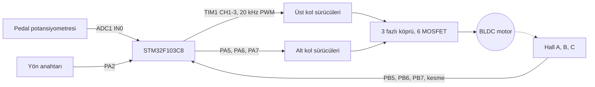

# STM32F103 ile hall sensörlü BLDC sürücü (altı adım)

Blue Pill (STM32F103C8) üzerinde çalışan, hall sensörlü fırçasız DC motoru altı adımlı komutasyonla süren yazılım. Hız bir pedal potansiyometresinden, yön bir anahtardan geliyor. Elektrikli araç ve e-bisiklet sürücülerinin en sade hali diyebilirim: akım kontrolü yok, sadece gerilim (duty) kontrolü var.

## Blok diyagram

## Pinler

| Pin | Görev | Açıklama |
|---|---|---|
| PA0 | Pedal | ADC1 kanal 0, 0 ile 3.3 V |
| PA2 | Yön | 0 ileri, 1 geri. Sadece motor dururken okunur |
| PA8 | A fazı üst kol | TIM1 CH1, PWM |
| PA9 | B fazı üst kol | TIM1 CH2, PWM |
| PA10 | C fazı üst kol | TIM1 CH3, PWM |
| PA5 | A fazı alt kol | GPIO, adım boyunca sürekli açık |
| PA6 | B fazı alt kol | GPIO |
| PA7 | C fazı alt kol | GPIO |
| PB5 | Hall A | iki kenarda kesme |
| PB6 | Hall B | iki kenarda kesme |
| PB7 | Hall C | iki kenarda kesme |

MOSFET'leri doğrudan işlemci pini süremez. Arada kapı sürücüsü (IR2101 benzeri) olmalı.

## Komutasyon

Her adımda bir fazın üst kolu PWM ile, başka bir fazın alt kolu sürekli açılıyor. Üçüncü faz boşta kalıyor. İleri yönde hall koduna karşılık gelen adımlar:

| Hall (A B C) | Adım | Üst kol, PWM | Alt kol |
|---|---|---|---|
| 1 0 1 | 1 | A | B |
| 1 0 0 | 2 | A | C |
| 1 1 0 | 3 | B | C |
| 0 1 0 | 4 | B | A |
| 0 1 1 | 5 | C | A |
| 0 0 1 | 6 | C | B |

Geri yönde aynı hall kodu için üç adım kaymış olan uygulanıyor (1 yerine 4, 2 yerine 5 gibi). 000 ve 111 geçersiz kod, bu durumda bütün çıkışlar kapanıyor.

Tablo `main.c` içinde `hall_to_step` ve `commutation` dizilerinde duruyor. Hall sırası motordan motora değişir. Motor titreyip dönmüyorsa önce hall kablolarının sırasını, sonra faz kablolarını değiştirerek dene.

## Nasıl çalışıyor

Hall sensörlerinden biri seviye değiştirdiğinde kesme geliyor ve `commutate()` yeni adımı uyguluyor. Aynı fonksiyon ana döngüden de milisaniyede bir çağrılıyor. Bunun iki sebebi var: pedal değiştiğinde duty hemen güncelleniyor ve motor dururken kesme gelmediği için kalkış da buradan sağlanıyor. Hall sensörleri dururken de konumu verdiği için ayrıca açık çevrim kalkış rutini yazmaya gerek kalmadı.

Bir fazın üst ve alt kolu hiçbir adımda aynı anda iletimde değil ve bir fazın üstten alta geçişi arasında her zaman boşta kaldığı bir adım var. Bu yüzden yazılımda ölü zaman eklemedim.

Pedal 150 değerini geçince motor kalkıyor, 100'ün altına inince bütün çıkışlar kapanıyor. Aradaki fark, pedal eşikte titrerken sürücünün açılıp kapanmasını önlüyor.

## Ayarlar

`main.c` başındaki sabitler:

| Sabit | Değer | Anlamı |
|---|---|---|
| `PWM_STEPS` | 100 | duty çözünürlüğü |
| `PWM_PRESCALER` | 3 | 8 MHz saatle 20 kHz PWM |
| `DUTY_MAX` | 95 | bootstrap sürücüler %100'de üst kolu tutamadığı için sınır |
| `THROTTLE_START` | 150 | kalkış eşiği (12 bit ADC) |
| `THROTTLE_STOP` | 100 | durma eşiği |

PWM zaman tabanı, hall kesmeleri ve SWD ayarı `motor_hw_init()` içinde elle yapılıyor. `.ioc` dosyasını yeniden üretsen de bu ayarlar bozulmaz.

## Derleme

STM32CubeIDE'de `File > Import > Existing Projects into Workspace` ile klasörü seç, derle ve karta yükle. İşlemci dahili 8 MHz osilatörle çalışıyor, kristal gerekmiyor.

## Eksikler

- Akım ölçümü ve aşırı akım koruması yok. İlk denemeyi akım sınırlı bir kaynakla yap.
- Hız çevrimi yok, pedal doğrudan duty'yi belirliyor.
- Fren ve geri kazanım yok, pedal bırakılınca motor serbest dönüyor.

## Durum

Kodu toparladıktan sonra motor üzerinde henüz denemedim. Derleniyor, ama güç katına bağlamadan önce çıkışları osiloskopla kontrol etmeni öneririm.

## Lisans

MIT. `Drivers` klasöründeki STM32 HAL ve CMSIS dosyaları kendi lisanslarıyla gelir.

## Yazar

Gömülü Sistem Mühendisi M. Eyüb Can, [TECH-OHM](https://tech-ohm.com)
